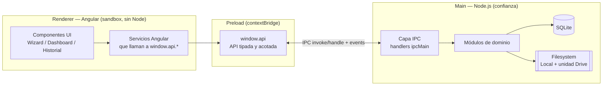
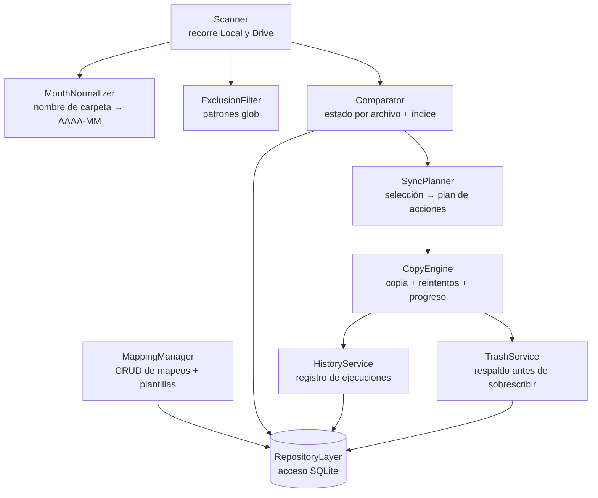
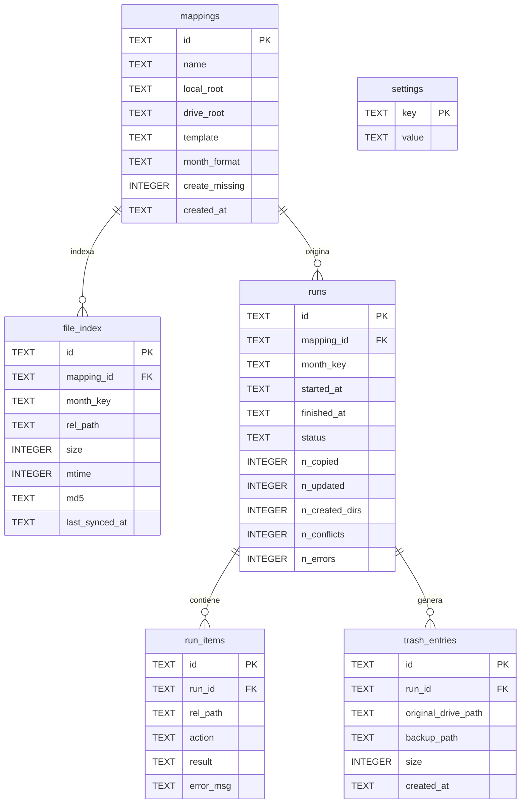
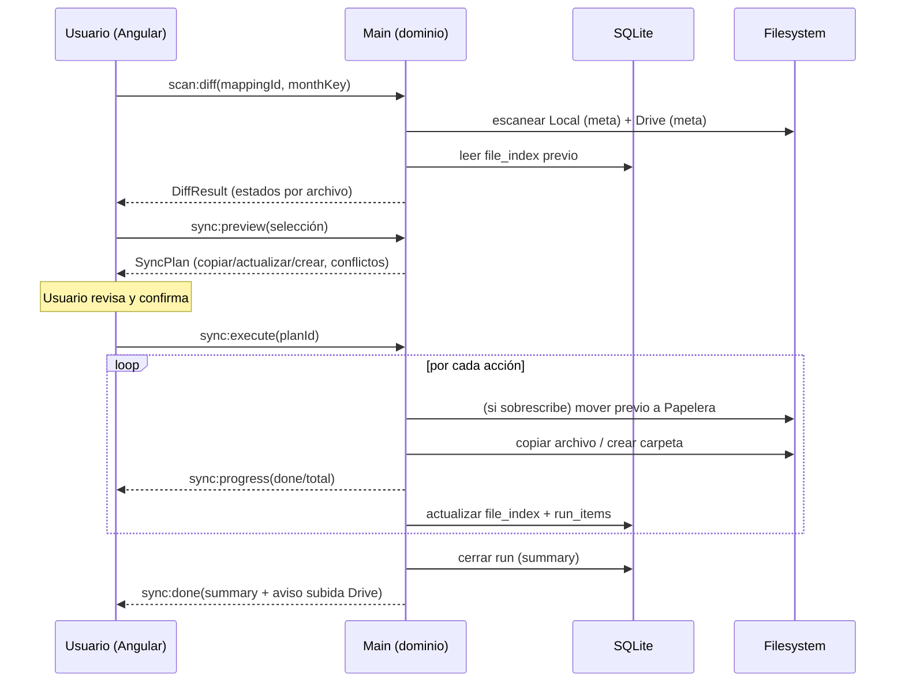

# Arquitectura — local-drive-sync

> Diseño técnico derivado de [`ESPECIFICACION.md`](ESPECIFICACION.md).
> Estado: **borrador v1** · Fecha: 2026-09-12 · Stack: Electron + Angular + SQLite

---

## 1. Principios de diseño

1. **Seguridad del usuario primero:** nada destructivo sin vista previa y confirmación; respaldo a Papelera antes de sobrescribir.
2. **Separación estricta UI / dominio:** Angular (renderer) nunca toca el disco directamente; todo el acceso a filesystem y datos vive en el proceso *main* (Node).
3. **El dominio es agnóstico de Electron:** los módulos de negocio (escáner, comparador, motor de copia…) son clases/funciones de TypeScript puro, testeables sin Electron.
4. **Incremental por defecto:** el índice SQLite evita reescaneos completos; comparación rápida `tamaño+fecha`, hash solo bajo demanda.
5. **Operaciones cancelables y observables:** toda tarea larga reporta progreso y puede abortarse.

---

## 2. Procesos de Electron y aislamiento



**Reglas de seguridad del renderer (no negociables):**

- `contextIsolation: true`, `nodeIntegration: false`, `sandbox: true`.
- El renderer **no** tiene acceso a `fs`, `path`, ni `require`. Solo ve `window.api`, una superficie mínima y tipada expuesta por el *preload* con `contextBridge`.
- Cada canal IPC valida sus argumentos en el *main* (nunca confiar en el renderer).

---

## 3. Comunicación IPC (contrato)

Dos estilos:

- **Petición/respuesta** (`ipcRenderer.invoke` → `ipcMain.handle`): operaciones con resultado.
- **Eventos** (`webContents.send` → `ipcRenderer.on`): progreso en vivo y notificaciones.

| Canal | Tipo | Entrada → Salida |
|---|---|---|
| `mappings:list` | invoke | `()` → `Mapping[]` |
| `mappings:save` | invoke | `MappingDraft` → `Mapping` |
| `mappings:delete` | invoke | `{ id }` → `void` |
| `scan:diff` | invoke | `{ mappingId, monthKey }` → `DiffResult` |
| `hash:verify` | invoke | `{ files[] }` → `HashResult[]` (avisa descarga en Stream) |
| `sync:preview` | invoke | `{ selection }` → `SyncPlan` |
| `sync:execute` | invoke | `{ planId }` → `RunId` |
| `sync:progress` | event | `{ runId, done, total, current, phase }` |
| `sync:done` | event | `{ runId, summary }` |
| `history:list` | invoke | `{ limit, offset }` → `RunSummary[]` |
| `history:detail` | invoke | `{ runId }` → `RunDetail` |
| `trash:list` | invoke | `()` → `TrashEntry[]` |
| `trash:restore` | invoke | `{ trashId }` → `void` |
| `settings:get` / `settings:set` | invoke | config (exclusiones, formato de mes…) |

Todas las operaciones largas devuelven un `runId`/`taskId` y emiten eventos de progreso; el *main* mantiene un `AbortController` por tarea para cancelación.

---

## 4. Módulos de dominio (main)



**Responsabilidades:**

- **MappingManager:** guarda/valida mapeos (`raízLocal`, `raízDrive`, plantilla con `{cliente}`/`{mes}`, formato de mes preferido `Mes-Año`, opciones como "crear carpeta faltante").
- **MonthNormalizer:** parsea nombres de carpeta en español (nombre o número de mes + año, varios separadores) a clave canónica `AAAA-MM`; expone mapeos manuales recordados para nombres no reconocidos.
- **Scanner:** recorre recursivamente un lado (Local o Drive), aplicando exclusiones; produce metadatos **sin hash** (ruta relativa, tamaño, `mtime`). En la unidad Drive lee solo metadatos (no materializa placeholders).
- **ExclusionFilter:** aplica patrones glob configurables.
- **Comparator:** combina el escaneo de ambos lados + el índice previo para asignar estado (`NUEVO`/`MODIFICADO`/`IGUAL`/`SOLO_EN_DRIVE`) y detectar conflictos.
- **SyncPlanner:** toma la selección del usuario y produce un `SyncPlan` inmutable (lista ordenada de acciones: crear carpeta, copiar, actualizar-con-respaldo). Es lo que se muestra en la vista previa.
- **CopyEngine:** ejecuta el plan con concurrencia limitada, reintentos ante "archivo en uso/bloqueado por Drive", progreso y cancelación.
- **TrashService:** antes de sobrescribir, mueve la versión previa a `%APPDATA%\local-drive-sync\trash\<runId>\...` y registra la entrada.
- **HistoryService:** persiste cada ejecución y su detalle por archivo.

---

## 5. Esquema de datos (SQLite)



Notas:
- `file_index` es el **estado incremental**: guarda lo conocido de la última sincronización (incluido `md5` solo si el usuario verificó por hash). Acelera `scan:diff`.
- `month_key` siempre en canónico `AAAA-MM`; el nombre "bonito" se reconstruye con `month_format`.
- Fechas como texto ISO-8601 UTC. Booleanos como `INTEGER 0/1`.
- Acceso vía una **capa repositorio** con sentencias preparadas (driver `better-sqlite3`, síncrono y rápido en el main).

---

## 6. Flujo de una sincronización (extremo a extremo)



---

## 7. Manejo de errores y casos límite

- **Archivo bloqueado / en uso por Drive:** reintento con *backoff* (N intentos); si falla, se marca ese `run_item` como error y la ejecución continúa con el resto.
- **Placeholder de Drive (Stream):** el escaneo nunca fuerza descarga; `hash:verify` avisa del coste antes de materializar.
- **Unidad de Drive no montada / ruta inexistente:** validación previa en `scan:diff`; error claro, sin ejecutar.
- **Corte de energía / cierre durante copia:** `runs.status = 'interrupted'`; la Papelera permite restaurar; el siguiente `scan:diff` reconcilia contra el estado real del disco.
- **Cancelación:** `AbortController` detiene tras la acción en curso; lo ya copiado queda registrado.
- **"Drive terminará de subir":** la UI muestra este aviso al cerrar la ejecución (no afirmamos subida confirmada).

---

## 8. Estructura de carpetas propuesta del proyecto

```text
local-drive-sync/
├── docs/                      # Especificación, arquitectura, UI
├── src/
│   ├── main/                  # Proceso main (Node)
│   │   ├── domain/            # Módulos de dominio (TS puro, testeable)
│   │   ├── persistence/       # Repositorios + migraciones SQLite
│   │   ├── ipc/               # Handlers ipcMain (validación)
│   │   └── main.ts            # Bootstrap de Electron
│   ├── preload/               # contextBridge → window.api
│   └── renderer/              # App Angular (UI)
├── electron-builder.yml       # Config del instalador
└── package.json
```

---

## 9. Decisiones técnicas abiertas (a cerrar antes de implementar)

1. **Driver SQLite:** `better-sqlite3` (síncrono, simple, rápido en main) — recomendado — vs `sql.js`. → *propuesta: better-sqlite3*.
2. **Empaquetado Angular dentro de Electron:** cómo se sirve el build de Angular al renderer (protocolo `file://` vs servidor interno). → *propuesta: cargar el build estático.*
3. **Concurrencia del CopyEngine:** nº de copias en paralelo (discos lentos vs unidad Drive). → *propuesta: configurable, por defecto 2–4.*
4. **Política de retención de Papelera:** por tiempo y/o tamaño máximo.

---

## 10. Próximo paso

Validada la arquitectura → **estructura del proyecto** (andamiaje Electron + Angular vacío pero ejecutable) y luego **diseño de UI** (pantallas del wizard). Aún sin lógica de negocio.
